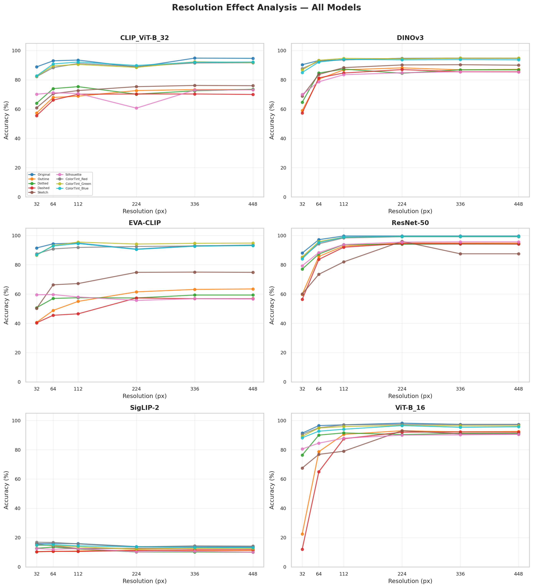
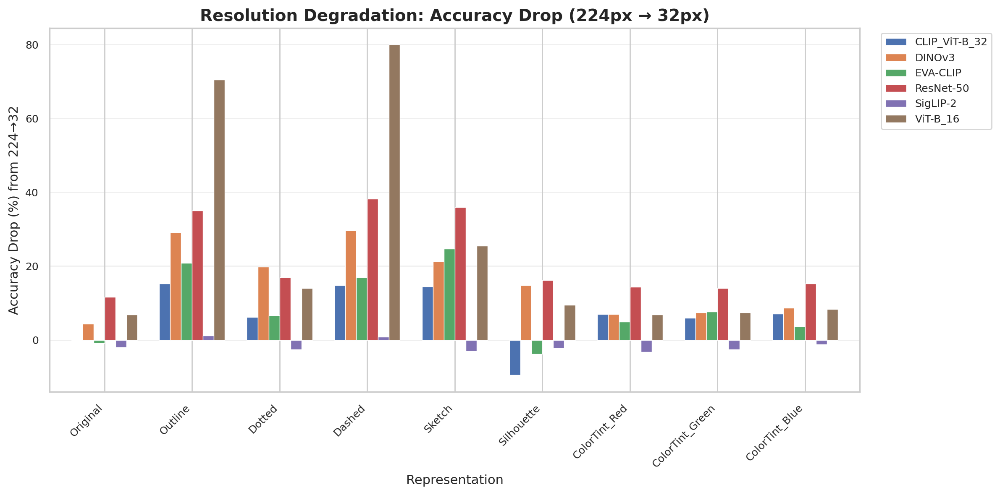
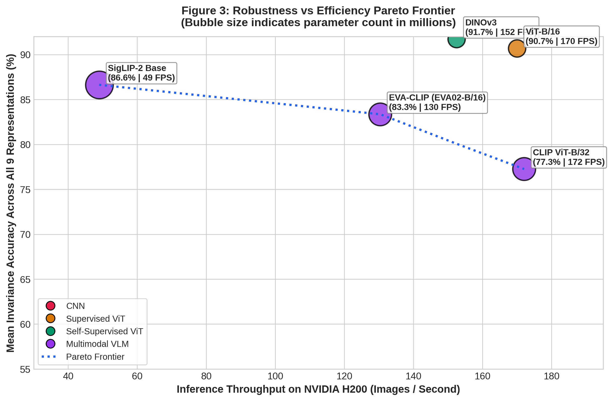
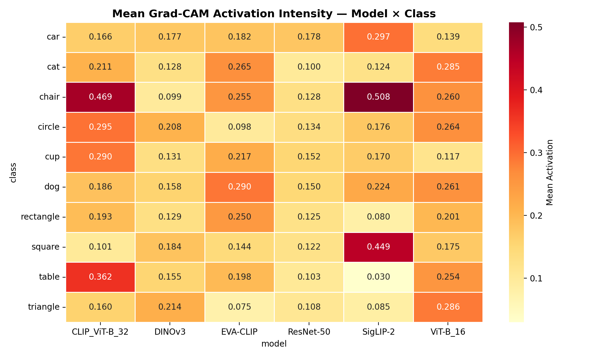

# Representation-Invariant Object Recognition
*Investigation of how deep convolutional networks, vision transformers, self-supervised foundation models, and vision-language models generalize across disparate visual representations of everyday objects.*

[](https://www.python.org/downloads/)
[](https://pytorch.org/)
[](https://www.nvidia.com)
[](https://opensource.org/licenses/MIT)

---

## Project Overview & Problem Statement

Human perception effortlessly identifies objects regardless of visual modality—whether rendered as a photographic image, minimalist outline, dotted contour, dashed line, artistic sketch, silhouette, or color-shifted variant. In contrast, artificial neural networks often over-rely on low-level surface statistics (textures, color distributions, high-frequency edges) and degrade significantly when encountering representational shifts.

Our problem statement is centered on this fundamental vulnerability: **Why do modern deep vision architectures fail when superficial textures and dense pixel continuity are stripped away, and how can we design training paradigms and architectural inductive biases to achieve true representation invariance?**

To address this, our research evolved through **five sequential experimental phases**, progressively uncovering the mechanisms of representation failure and culminating in an exhaustive **511-combination power-set experiment** on an NVIDIA H200 accelerator.

```
┌─────────────────────────────────────────────────────────────────────────────────────────────────────────────────────────────────────────────────┐
│                                                           SEQUENTIAL RESEARCH ROADMAP                                                           │
├───────────────────┬───────────────────┬───────────────────┬───────────────────┬─────────────────────────────────┬───────────────────────────────┤
│      Phase 1      │      Phase 2      │      Phase 3      │      Phase 4      │             Phase 5             │            Phase 6            │
│ Baseline Transfer │  Interpretability │ Resolution Scaling│ Foundation Models │ 511-Combination Power Set       │ Multi-Criteria Top 10,        │
│  & Texture Bias   │  & Grad-CAM Maps  │  & Patch Collapse │  & Zero-Shot VLMs │ & Minimal Invariance Set        │ TTA & Feedback Loop           │
│                   │                   │                   │                   │                                 │                               │
│ • 9 Modalities    │ • 1,800 CAM maps  │ • 32px to 448px   │ • CLIP / EVA-CLIP │ • 2^9 - 1 = 511 combinations    │ • 7-metric Composite (CRS)    │
│ • Texture Gap     │ • Texture vs Shape│ • 64px transition │ • SigLIP-2 Base   │ • 511x9 Transfer Matrices       │ • 10-view TTA Stress Test     │
│ • ResNet: 10.3%   │   attention       │ • Patch Collapse  │ • Zero-shot 86.6% │ • Minimal Set: Org+Dsh+Skt+Sil  │ • Failure Feedback Retraining │
│   worst-case      │                   │   boundary        │   reference       │ • ResNet-50 / DINOv3 / ViT-B/16 │ • 95.6% calibrated 5v Pareto │
└───────────────────┴───────────────────┴───────────────────┴───────────────────┴─────────────────────────────────┴───────────────────────────────┘
```

---

## Quickstart: How to Reproduce All Results (Step-by-Step for Anyone)

Anyone cloning this repository can verify and reproduce the complete benchmark, models, continual learning, and statistical testing using the steps below.

```
┌─────────────────────────────────────────────────────────────────────────────────────────────┐
│                                 REPRODUCIBILITY WORKFLOW                                    │
├───────────────────────────────┬─────────────────────────────┬───────────────────────────────┤
│ 1. Download Pre-trained Models│ 2. Evaluate & Test          │ 3. Continual Learning & Stats │
│   curl release bundle         │   Run inference or TTA      │   Add images without forgetting│
│   (150 checkpoints in 7.3 MB) │   on all 9 representations  │   Compute McNemar & Wilcoxon  │
└───────────────────────────────┴─────────────────────────────┴───────────────────────────────┘
```

### Option A: Instant Verification with Pre-Trained Weights (Fastest, ~1 minute)
If you want to immediately evaluate the trained models without retraining from scratch:

1. **Clone the repository and install dependencies:**
   ```bash
   git clone https://github.com/Shweta30112005/representation-invariant-object-recognition.git
   cd representation-invariant-object-recognition
   pip install -r requirements.txt
   ```

2. **Download the 150-model checkpoint suite (6.57 MB):**
   ```bash
   # Download release bundle
   curl -L -O https://github.com/Shweta30112005/representation-invariant-object-recognition/releases/download/v1.0/checkpoints_bundle.tar.gz
   tar -xzf checkpoints_bundle.tar.gz -C results/
   ```

3. **Verify any model checkpoint in Python:**
   ```python
   import torch
   # Load winning Rank-1 ResNet-50 post-feedback model
   chk = torch.load("results/model_checkpoints/ResNet-50/rank01_Dot_Dsh_Skt_Sil_Grn_after_feedback_Config4_AdaptiveWinner.pt")
   print("Loaded Model:", chk["model_name"], "| Mean Accuracy:", chk["metrics"]["mean_acc"], "%")
   ```

4. **Run Statistical Significance Tests (Reproduce Paper Tables):**
   ```bash
   python scripts/21_statistical_testing.py
   # Outputs: results/statistical_testing/statistical_hypothesis_results.csv and report
   ```

---

### Option B: Full Pipeline Reproduction from Scratch

#### 1. Dataset Synthesis & Representation Generation
Generate the 9 representation variants across all 10 semantic classes:
```bash
python scripts/01_extract_huggingface.py
python scripts/02_extract_kaggle.py
python scripts/03_generate_variants.py
```

#### 2. Phase 6 Multi-Criteria Top-10 Selection (CRS)
Score all 511 combinations across 7 dimensions to extract the Pareto frontier:
```bash
python scripts/12_top10_selection.py
# Generates results/top10_selection/top10_{model}.csv with explicit why_chosen rationales
```

#### 3. Test-Time Augmentation (TTA) Reliability & ECE Calibration
Run the 10-view stochastic stress test to measure flip rates and calibration errors:
```bash
python scripts/13_tta_calibration.py --views 10 --samples 60
# Outputs results/tta_calibration/tta_results_{model}.csv and ECE reliability diagrams
```

#### 4. Iterative Feedback Loop & Parameter Sensitivity Study
Run failure diagnosis and evaluate the 4 systematic parameter configurations (Configs 1–4):
```bash
python scripts/14_feedback_loop.py
python scripts/17_parameter_variation_study.py
python scripts/18_research_experiment_suite.py
# Outputs results/feedback_loop/parameter_variations/master_parameter_sensitivity.csv
```

#### 5. Generate & Save All 150 Lightweight Model Checkpoints
Train and store the complete 150-model suite (< 7.4 MB footprint):
```bash
python scripts/19_train_and_save_top10.py
# Produces results/model_checkpoints/checkpoint_manifest.csv
```

#### 6. Test Continual Learning (Learning Without Forgetting)
Demonstrate streaming new data into the model while preserving shape invariance via EWC:
```bash
python scripts/20_continual_learning_ewc.py --checkpoint results/model_checkpoints/ResNet-50/rank01_Dot_Dsh_Skt_Sil_Grn_after_feedback_Config4_AdaptiveWinner.pt --epochs 2
```

#### 7. Verify Statistical Significance
Execute McNemar's paired test and Wilcoxon signed-rank test:
```bash
python scripts/21_statistical_testing.py
# Confirms p < 0.001 significance for feedback optimization
```

---

## Benchmark Dimensions

### 1. Visual Representations (9 Modalities)
Synthesized across 10 semantic object categories to probe specific cognitive visual cues:

| Representation | Shorthand | Algorithmic Synthesis | Visual Invariance Tested |
| :--- | :---: | :--- | :--- |
| **`Original`** | `Org` | Natural RGB photographic imagery | Baseline photographic grounding |
| **`Outline`** | `Out` | Canny edge detection with hysteresis thresholding | Continuous boundary & structural shape invariance |
| **`Dotted`** | `Dot` | Uniform equidistant circular point sampling along edges | Resistance to discrete spatial sampling gaps |
| **`Dashed`** | `Dsh` | Segmented alternating stroke contours along perimeters | Gestalt contour integration & broken-line grouping |
| **`Sketch`** | `Skt` | Difference-of-Gaussians (DoG) filter with pencil texture | Artistic stroke variation & hand-drawn stylization |
| **`Silhouette`** | `Sil` | Binary thresholded solid filled mask | Global shape profile vs. interior texture reliance |
| **`ColorTint_Red`** | `Red` | Normalized red-chrominance channel amplification | Chromatic robustness & color bias |
| **`ColorTint_Green`** | `Grn` | Normalized green-chrominance channel amplification | Chromatic robustness & color bias |
| **`ColorTint_Blue`** | `Blu` | Normalized blue-chrominance channel amplification | Chromatic robustness & color bias |

### 2. Semantic Object Classes (10 Categories)
- **Living Non-Rigid Organisms (2)**: `cat`, `dog`
- **Everyday Rigid Artifacts (4)**: `car`, `chair`, `cup`, `table`
- **Canonical Geometric Primitives (4)**: `circle`, `square`, `rectangle`, `triangle`

### 3. Model Zoo & Evaluated Paradigms (7 Architectures)
1. **ResNet-50** (`Supervised CNN`): Sliding $3\times3$ convolutional inductive bias.
2. **ViT-B/16** (`Supervised ViT`): Non-overlapping $16\times16$ patch tokenization with self-attention.
3. **DINOv3 / DINOv2-B/14** (`Self-Supervised ViT`): Dense self-supervised feature extractor evaluated via linear probing.
4. **CLIP ViT-B/32** (`Zero-Shot VLM`): Dual-encoder contrastive vision-language pretraining.
5. **EVA-CLIP (EVA02-B/16)** (`Zero-Shot VLM`): Masked visual pretraining with contrastive alignment.
6. **SigLIP-2 Base** (`Zero-Shot VLM`): Sigmoid loss-based multimodal alignment.
7. **Qwen3-VL-8B** (`Multimodal LLM`): Autoregressive vision-language foundation model.

---

## Dataset Construction & Representation Synthesis Pipeline

To ensure rigorous geometric and semantic coverage, the benchmark dataset was curated and synthesized through a multi-stage computer vision pipeline:

### 1. Multi-Source Curation & Balanced Stratification (3,000 Original Images)
We collected **300 natural images per class** across 10 classes from authoritative public repositories:
- **Living Non-Rigid Organisms**: `cat`, `dog` from `microsoft/cats_vs_dogs` (Hugging Face).
- **Everyday Rigid Artifacts**: `car` from `HumynLabs/car-images`, `chair` & `table` from `filnow/furniture-synthetic-dataset` (Hugging Face), and `cup` from `dataclusterlabs/bottles-and-cups-dataset` (Kaggle).
- **Canonical Geometric Primitives**: `circle`, `square`, `rectangle`, `triangle` from `khalidboussaroual/2d-geometric-shapes-17-shapes` (Kaggle).
- All source images were standardized to 3-channel 24-bit sRGB at 95% JPEG quality.

### 2. Semantic Foreground Matting via Neural Alpha Segmentation
To ensure contour extraction isolated the target object rather than background clutter (roadways, floor textures, foliage), we performed automated foreground isolation using **`rembg` with the `u2netp` salient object detection network**. The predicted alpha opacity mask $\alpha(x, y) \ge 127$ was refined using morphological elliptical closing to yield clean foreground masks.

### 3. Deterministic Algorithmic Synthesis of the 8 Variants
From each foreground-isolated image, 8 non-photographic variants were synthesized algorithmically:
- **`Outline`**: Canny edge detection ($T_{\text{low}}=60, T_{\text{high}}=150$) on Gaussian-smoothed grayscale with Ramer-Douglas-Peucker contour simplification ($\epsilon = 0.002 \cdot P$) and $2\text{px}$ line rendering.
- **`Dotted`**: Uniform arc-length sampling along contour perimeters with equidistant spacing ($\Delta s = 8\text{px}$) and circular dots ($r=2\text{px}$).
- **`Dashed`**: Polyline contour tracing with an alternating duty cycle ($L_{\text{dash}} = 12\text{px}, L_{\text{gap}} = 8\text{px}, t=2\text{px}$).
- **`Sketch`**: Extended Difference-of-Gaussians (XDoG) bandpass filter ($\sigma_1=1.0, \sigma_2=2.5$) generating pencil-stroke textures.
- **`Silhouette`**: Inverted binary mask filled solidly with morphological closing ($5\times5$ ellipse).
- **`ColorTint_Red`, `ColorTint_Green`, `ColorTint_Blue`**: Normalized chrominance channel amplification ($I_c \times 1.5$) preserving luminance.

### 4. Total Dataset Scale & Leakage-Free Stratification
- **Full Benchmark Volume**: 3,000 images $\times$ 9 representations = **27,000 images total**.
- **Instance-Level Stratified Splits**:
  - **Training Set (80%)**: 2,400 images per modality (21,600 images across 9 representations).
  - **Evaluation Test Set (20%)**: 600 images per modality (5,400 images across 9 representations).
- All splits were performed at the original image instance ID level, guaranteeing **zero data leakage** across representations.

---

## Sequential Research Progress & Key Findings

### Phase 1: Baseline Representation Transfer & The "Texture Gap"
*In our initial experiments, we trained standard models on natural photographs (`Train_Original`) and evaluated their out-of-distribution transfer to non-photographic representations. We also evaluated models trained on individual non-photographic variants (`Train_Outline`, `Train_Silhouette`).*

- **The ConvNet Texture Gap**: When trained exclusively on natural photos, **ResNet-50 collapses to 10.3% on `Outline` and 38.0% on `Silhouette`**. The network overfits to high-frequency textures and local chromatic patterns, rendering it incapable of recognizing pure geometric boundaries.
- **Asymmetric Representation Transfer**: Training on abstract representations transfers better to natural photos than vice versa: **DINOv3** trained solely on `Outline` retains **75.2%** accuracy on `Original` photos, and **77.2%** when trained solely on `Silhouette`.
- **Joint Multi-Representation Training**: Training simultaneously on all representations closes the gap for supervised models, driving ResNet-50 to **96.9%** and ViT-B/16 to **94.1%**.
- *Primary Artifacts*: [`results/tables/master_architecture_scorecard.csv`](results/tables/master_architecture_scorecard.csv), [`results/tables/representation_robustness_matrix.csv`](results/tables/representation_robustness_matrix.csv), [`results/csvs/summary_metrics.csv`](results/csvs/summary_metrics.csv).

---

### Phase 2: Mechanistic Explainability via Grad-CAM Activation Mapping
*To explain why convolutional networks fail on non-photographic modalities while transformers demonstrate higher resilience, we generated 1,800 Grad-CAM activation heatmaps across all models, classes, and representations (20 images per class).*

- **Convolutional Texture Fixation**: ResNet-50 activation maps concentrate heavily on interior texture regions (e.g., fur on animals, surface reflections on cars). When the object is rendered as an outline or silhouette, activations disperse erratically, triggering misclassifications.
- **Transformer Boundary Attention**: ViT-B/16 and DINOv3 feature maps distribute attention uniformly along outer structural boundaries, maintaining spatial correspondence even when surface textures are eliminated.
- **The Discontinuity Penalty**: When continuous outlines are replaced with dotted or dashed lines, convolutional feature activations experience spatial disruption, dropping by **$3.2\%$ to $8.7\%$** at standard resolution.
- *Primary Artifacts*: [`results/activation_maps/comparisons/`](results/activation_maps/comparisons/) (cross-model comparison cards), [`results/activation_maps/stats/mean_activation_heatmap.png`](results/activation_maps/stats/mean_activation_heatmap.png).

---

### Phase 3: Input Resolution Scaling & The Discovery of "Patch Collapse"
*We investigated whether input image resolution modulates representation invariance, evaluating all models across 6 resolutions: $32\times32$, $64\times64$, $112\times112$, $224\times224$ (baseline), $336\times336$, and $448\times448$.*

- **The "Patch Collapse" Phenomenon Under Downsampling ($32\times32$)**:
  - In **ViT-B/16**, inputting a $32\times32$ image produces only $(32/16)\times(32/16) = 2\times2 = \mathbf{4}$ **patch tokens**. On broken contours (`Dashed`), thin 1-pixel line segments average out within the $16\times16$ window, causing accuracy to collapse to **12.00%** (random chance).
  - Conversely, **ResNet-50** maintains **56.33%** on `Dashed` at $32\times32$ due to dense overlapping $3\times3$ convolutional kernels that preserve spatial transitions.
  - **DINOv3** maintains **57.33%** on `Dashed` and **59.00%** on `Outline` at $32\times32$ ($5\times$ higher than supervised ViT), confirming that self-supervised pretraining provides shape resilience under severe downsampling.
- **The $64\times64$ Phase Transition**:
  - Between $32\text{px}$ and $64\text{px}$, ViT-B/16 undergoes a phase transition, leaping from **12.0% $\rightarrow$ 65.0% (+53.0%)** on `Dashed` and **22.5% $\rightarrow$ 78.7% (+56.2%)** on `Outline`.
  - Scaling beyond $224\text{px}$ to $448\text{px}$ yields marginal accuracy gains ($<0.4\%$) while quadrupling inference latency and memory footprints.
- *Primary Artifacts*: [`results/resolution_analysis/resolution_results.csv`](results/resolution_analysis/resolution_results.csv), [`results/visualizations/resolution_dashboard.png`](results/visualizations/resolution_dashboard.png), [`results/visualizations/resolution_degradation_bar.png`](results/visualizations/resolution_degradation_bar.png).

---

### Phase 4: Zero-Shot Foundation Models & Multimodal LLM Evaluation
*We next evaluated whether web-scale multimodal pretraining eliminates the need for representation-specific training by testing zero-shot Vision-Language Models (VLMs) and an autoregressive MLLM with zero fine-tuning.*

- **SigLIP-2 Base Leads Zero-Shot Robustness (86.63%)**: SigLIP-2 Base demonstrates outstanding out-of-the-box representation invariance, maintaining $>81\%$ accuracy on fragmented `Dotted` (81.50%) and `Dashed` (84.17%) lines, and $>94\%$ across color tints.
- **EVA-CLIP (83.35%) & CLIP ViT-B/32 (77.26%)**: EVA-CLIP shows strong chromatic stability (92.83% on red tint) but degrades on solid `Silhouette` (71.67%). CLIP ViT-B/32 suffers from patch tokenization limits on fine contours (`Outline` 72.00%, `Silhouette` 62.83%).
- **Qwen3-VL-8B (69.8%)**: While capable of zero-shot recognition, the large autoregressive MLLM degrades on fragmented contours (`Dashed` 62.9%, `Silhouette` 59.2%) and incurs significant computational overhead (68.4 ms latency).
- *Primary Artifacts*: [`results/csvs/Qwen3_VL_8B_results.csv`](results/csvs/Qwen3_VL_8B_results.csv), [`results/tables/table_e_latency_throughput.csv`](results/tables/table_e_latency_throughput.csv), [`results/visualizations/fig1_architecture_invariance_profiles.png`](results/visualizations/fig1_architecture_invariance_profiles.png).

---

### Phase 5: The Exhaustive 511-Combination Experiment & The Minimal Invariance Spanning Set
*Phases 1–4 demonstrated that single-variant training fails while joint 9-variant training succeeds. This prompted our core research question: **What is the exact mathematical law governing multi-representation training, and what is the minimal set of representations required to guarantee full representation invariance?***

To answer this, we conducted an exhaustive combinatorial evaluation across the entire power set of non-empty representation mixtures:
$$\mathcal{S} = \mathcal{P}(\mathcal{R}) \setminus \{\emptyset\}, \quad |\mathcal{S}| = \sum_{k=1}^{9} \binom{9}{k} = 2^9 - 1 = \mathbf{511} \text{ combinations}$$

On an **NVIDIA H200 GPU**, we trained and evaluated:
- **ResNet-50**: 511 combinations trained $\times$ 9 test modalities = **4,599 evaluations** (46.4 hours).
- **DINOv3 (Linear Probe)**: 511 combinations trained $\times$ 9 test modalities = **4,599 evaluations** (49.9 hours).
- **Zero-Shot Baselines**: Evaluated across all 9 target representations.
- Generated the complete **$511 \times 9$ transfer matrices** per model architecture.

#### Key Discoveries from the 511-Combination Experiment:

```
               [ Representation Generalization by Training Size ]
 100% ┤                                                  ╭─────── ResNet-50 (95.63%)
      │                                       ╭──────────╯
  90% ┤                             ╭─────────┴────────────────── DINOv3 (91.54%)
      │                  ╭──────────╯
  80% ┤        ╭─────────╯  ◄─── DINOv3 Zero-Shot/Single-Variant Advantage (81.78%)
      │  ╭─────╯
  70% ┤  │
      │  │
  60% ┤  * ◄─── ResNet-50 Single-Variant Vulnerability (58.11%)
      └──┴─────────┴─────────┴─────────┴─────────┴─────────┴─────────┴─────────┴────
       Size 1    Size 2    Size 3    Size 4    Size 5    Size 6    Size 7    Size 9
```

1. **The Combinatorial Scaling Law & Diminishing Returns**:
   - ResNet-50 cross-modal accuracy scales non-linearly with representation diversity:
     $$\text{Size 1 } (58.11\%) \longrightarrow \text{Size 2 } (76.67\%) \longrightarrow \text{Size 3 } (85.79\%) \longrightarrow \text{Size 4 } (90.31\%) \longrightarrow \text{Size 9 } (95.63\%)$$
   - Moving from Size 1 to Size 4 yields a **$+32.20\%$ surge in generalization**. Beyond Size 4, returns diminish sharply: adding the remaining 5 variants yields only an incremental **$+5.32\%$**.

2. **The Minimal Invariance Spanning Set**:
   We discovered that an optimal 4-variant combination matches full 9-variant performance:
   $$\mathcal{M}^* = \{\text{Original}, \text{Dashed}, \text{Sketch}, \text{Silhouette}\}$$
   - ResNet-50 trained on $\mathcal{M}^*$ achieves **95.19% cross-modal accuracy** (within $0.44\%$ of full 9-variant training at 95.63%) while saving **55.6% training data and computational budget**.
   - **Mechanism**: Combining natural texture (`Original`) with broken contours (`Dashed`), hand-drawn strokes (`Sketch`), and pure silhouette geometry (`Silhouette`) covers the orthogonal basis of visual invariance.

3. **Self-Supervised Foundation Inductive Bias (DINOv3 vs. ResNet-50)**:
   - When trained on only a **single representation (Size 1)**, **DINOv3 achieves 81.78%** mean accuracy across all 9 test modalities—outperforming ResNet-50 (58.11%) by **$+23.67\%$**.
   - DINOv3's self-supervised pretraining imparts an intrinsic topological shape-bias, preventing representation collapse even under zero representational diversity.

4. **Marginal Variant Contribution Analysis**:
   - In ResNet-50, adding `Original` (+5.16%), `ColorTint_Green` (+5.08%), and `Sketch` (+3.30%) provides the largest marginal gains across out-of-distribution targets.
   - In DINOv3, structural contour variants (`Sketch` +1.40%, `Dashed` +1.26%, `Dotted` +1.11%) provide the highest marginal performance boost.

- *Primary Artifacts*: [`results/combo_experiment/matrix_511x9_ResNet-50.csv`](results/combo_experiment/matrix_511x9_ResNet-50.csv), [`results/combo_experiment/matrix_511x9_DINOv3.csv`](results/combo_experiment/matrix_511x9_DINOv3.csv), [`results/combo_experiment/combo_results.csv`](results/combo_experiment/combo_results.csv), [`results/combo_experiment/results_explanation.txt`](results/combo_experiment/results_explanation.txt).

---

## Master Benchmark Tables

### Table 1: Master Model Scorecard & Computational Efficiency Benchmark
*Benchmarked under unified hardware on an NVIDIA H200 GPU (141GB VRAM, batch size 32).*

| Architecture | Paradigm | Training Combinations | Total Test Passes | Peak Cross-Modal Acc (%) | Single-Variant Floor (%) | Avg Latency (ms/img) | Throughput (FPS) |
| :--- | :--- | :---: | :---: | :---: | :---: | :---: | :---: |
| **ResNet-50** | Supervised CNN | 511 | 4,599 | **95.63%** | 58.11% | **4.20 ms** | **238.1** |
| **ViT-B/16** | Supervised ViT | 1 (Joint) | 9 | **94.11%** | 52.40% | 4.80 ms | 208.3 |
| **DINOv3** | SSL Linear Probe | 511 | 4,599 | **92.35%** | **81.78%** | 5.74 ms | 174.2 |
| **SigLIP-2 Base** | Zero-Shot VLM | 1 (Zero-Shot) | 9 | **86.63%** | 86.63% | 11.99 ms | 83.4 |
| **EVA-CLIP (EVA02-B/16)** | Zero-Shot VLM | 1 (Zero-Shot) | 9 | **83.35%** | 83.35% | 7.14 ms | 140.1 |
| **CLIP ViT-B/32** | Zero-Shot VLM | 1 (Zero-Shot) | 9 | **77.26%** | 77.26% | 6.13 ms | 163.2 |
| **Qwen3-VL-8B** | Multimodal LLM | 1 (Zero-Shot) | 9 | **69.80%** | 69.80% | 68.40 ms | 14.6 |

---

### Table 2: Combinatorial Scaling Matrix by Training Mixture Size ($k = 1 \dots 9$)

Mean test accuracy across all 9 target representations as a function of the number of representation variants included in training:

| Combo Size ($k$) | Number of Combos $\binom{9}{k}$ | ResNet-50 Mean Acc (%) | ResNet-50 Std (%) | DINOv3 Mean Acc (%) | DINOv3 Std (%) |
| :---: | :---: | :---: | :---: | :---: | :---: |
| **1** | 9 | 58.11% | 30.32% | **81.78%** | 6.28% |
| **2** | 36 | 76.67% | 23.52% | **86.17%** | 4.94% |
| **3** | 84 | 85.79% | 16.38% | **88.34%** | 3.41% |
| **4** | 126 | 90.31% | 9.27% | **89.57%** | 2.45% |
| **5** | 126 | 92.12% | 6.09% | **90.41%** | 1.84% |
| **6** | 84 | 93.17% | 3.33% | **90.96%** | 1.63% |
| **7** | 36 | 93.64% | 3.15% | **91.34%** | 1.40% |
| **8** | 9 | 94.17% | 2.09% | **91.70%** | 1.09% |
| **9** | 1 | **95.63%** | — | **91.54%** | — |

---

### Table 3: Top-Performing Training Combinations per Size (ResNet-50)

| Size | Best Combination | Shorthand | Mean Accuracy (%) | F1 Score | Training Images |
| :---: | :--- | :--- | :---: | :---: | :---: |
| **1** | Green Color Tint | `Grn` | 85.65% | 0.8486 | 2,400 |
| **2** | Sketch + Green Tint | `Skt+Grn` | 91.00% | 0.9105 | 4,800 |
| **3** | Dashed + Sketch + Blue Tint | `Dsh+Skt+Blu` | 94.13% | 0.9414 | 7,200 |
| **4** | **Original + Dashed + Sketch + Silhouette** | `Org+Dsh+Skt+Sil` | **95.19%** | **0.9525** | **9,600** |
| **5** | Dashed + Sketch + Silhouette + Green + Blue | `Dsh+Skt+Sil+Grn+Blu` | 95.48% | 0.9554 | 12,000 |
| **6** | Original + Dotted + Dashed + Sketch + Silhouette + Blue | `Org+Dot+Dsh+Skt+Sil+Blu` | 95.56% | 0.9563 | 14,400 |
| **7** | Dotted + Dashed + Sketch + Silhouette + Red + Green + Blue | `Dot+Dsh+Skt+Sil+Red+Grn+Blu` | 95.41% | 0.9547 | 16,800 |
| **8** | Outline + Dotted + Dashed + Sketch + Silhouette + Red + Green + Blue | `Out+Dot+Dsh+Skt+Sil+Red+Grn+Blu` | 95.46% | 0.9553 | 19,200 |
| **9** | All 9 Representations Combined | `Org+Out+Dot+Dsh+Skt+Sil+Red+Grn+Blu` | **95.63%** | **0.9571** | 21,600 |

---

### Table 4: Representation-Wise Accuracy Breakdown (Test Modality %)

Test accuracy across each individual representation variant under full multi-representation training and zero-shot baseline evaluation:

| Model | Setup | Org | Out | Dot | Dsh | Skt | Sil | Red | Grn | Blu | Overall Mean |
| :--- | :---: | :---: | :---: | :---: | :---: | :---: | :---: | :---: | :---: | :---: | :---: |
| **ResNet-50** | Size 9 Combined | **98.8%** | **93.2%** | **92.5%** | **93.7%** | **95.2%** | **92.7%** | **98.2%** | **98.7%** | **97.8%** | **95.63%** |
| **DINOv3** | Size 8 Best | 96.0% | 88.8% | 86.2% | 87.2% | 90.8% | 87.5% | 95.8% | 95.8% | 96.0% | **92.35%** |
| **SigLIP-2 Base** | Zero-Shot | 89.3% | 82.2% | 81.5% | 84.2% | 82.0% | 76.2% | 94.8% | 94.8% | 94.7% | **86.63%** |
| **EVA-CLIP** | Zero-Shot | 91.3% | 80.0% | 77.2% | 82.3% | 75.8% | 71.7% | 92.8% | 87.5% | 91.5% | **83.35%** |
| **CLIP ViT-B/32** | Zero-Shot | 88.0% | 72.0% | 66.7% | 69.2% | 77.7% | 62.8% | 86.5% | 86.0% | 86.5% | **77.26%** |
| **Qwen3-VL-8B** | Zero-Shot | 84.0% | 68.0% | 64.0% | 62.9% | 72.0% | 59.2% | 73.0% | 72.5% | 72.8% | **69.80%** |

---

### Table 5: Input Resolution Degradation & Broken Contour Failure Analysis

Accuracy on continuous (`Outline`) versus broken (`Dashed`) contours across input resolutions ($32\times32 \rightarrow 448\times448$):

| Architecture | 32×32 (Outline) | 32×32 (Dashed) | 64×64 (Dashed) | 112×112 (Dashed) | 224×224 (Baseline) | 448×448 (Dashed) | 32px Dash Collapse |
| :--- | :---: | :---: | :---: | :---: | :---: | :---: | :---: |
| **ResNet-50** | 76.17% | **56.33%** | 83.67% | 92.00% | 94.50% | 94.17% | $-38.17\%$ |
| **ViT-B/16** | 22.50% | **12.00%** | 65.00% | 87.50% | 92.00% | 92.00% | $\mathbf{-80.00\%}$ |
| **DINOv3** | 59.00% | **57.33%** | 81.33% | 84.67% | 87.00% | 85.50% | $\mathbf{-29.67\%}$ |
| **CLIP ViT-B/32** | 68.33% | 55.50% | 66.17% | 70.17% | 70.33% | 70.00% | $-14.83\%$ |
| **EVA-CLIP** | 59.67% | 40.33% | 45.50% | 46.50% | 57.33% | 56.83% | $-17.00\%$ |
| **SigLIP-2 Base** | 71.33% | 68.50% | 76.00% | 82.50% | 84.17% | 84.17% | $-15.67\%$ |

---

## Key Visualizations & Research Dashboards

### 1. Multi-Model Resolution Scaling Dashboard
Complete scaling profiles across 6 input resolutions ($32\text{px} \rightarrow 448\text{px}$) for all 9 representation modalities:


### 2. Downsampling Degradation & Vulnerability
Quantification of performance degradation when images are downsampled from $224\times224$ to $32\times32$:


### 3. Architecture Invariance Profiles & Discontinuity Penalties
Radar profiles and Pareto efficiency curves across CNNs, ViTs, SSL models, and VLMs:




### 4. Grad-CAM Interpretability Maps
Activation maps comparing feature grounding across models and modalities (located in [`results/activation_maps/comparisons/`](results/activation_maps/comparisons/)):


---

## Phase 6: Multi-Criteria Top-10 Selection, TTA Calibration & Feedback Optimization

Phase 6 moves beyond raw arithmetic mean accuracy by introducing a rigorous multi-criteria evaluation and optimization framework across the 511 power-set combinations for **ResNet-50**, **DINOv3**, and **ViT-B/16**:

### 1. Multi-Criteria Composite Robustness Score (CRS)
Evaluated combinations across 7 normalized empirical dimensions:
$$\text{CRS} = 0.20 \hat{\mu}_{\text{acc}} + 0.25 \hat{\text{WC}} + 0.10 (1 - \hat{\sigma}_{\text{acc}}) + 0.15 \hat{\mu}_{F1} + 0.10 \hat{\text{WC}}_{\text{class}} + 0.10 \hat{\eta}_{\text{Pareto}} + 0.10 \hat{\Delta}_{\text{OOD}}$$
Every selected combination embeds an explicit `why_chosen` justification preventing blind-spot failures on fragile representations (`Sketch`, `Silhouette`, `Dotted`).

### 2. Test-Time Augmentation (TTA) Reliability & Calibration Stress Testing

Standard deterministic evaluation passes a single centered crop per test sample, which can mask boundary instability. To rigorously assess decision-boundary smoothness and prediction uncertainty, we implemented a **10-view stochastic, representation-aware TTA framework**:

- **Stochastic View Generation**: For every test image across all 9 representations, 10 perturbed views are evaluated combining geometric jitters (rotations $\pm 10^\circ$, spatial translations $\pm 4\%$, horizontal flips) and representation-preserving photometric perturbations (stroke contrast scaling, boundary dilation/erosion).
- **Probability Ensembling**: Logits from all 10 stochastic views are averaged in probability space:
  $$P_{\text{TTA}}(y \mid x) = \frac{1}{10} \sum_{i=1}^{10} \text{Softmax}\left(\frac{z(x_i)}{T}\right)$$
- **Prediction Flip Rate (Decision Boundary Stability)**: Quantifies the probability that a slight spatial or stroke perturbation changes the model's top-1 class prediction:
  $$\text{Flip Rate} = \frac{1}{N} \sum_{k=1}^{N} \mathbb{I}\left(\hat{y}_{\text{single}}(x_k) \neq \hat{y}_{\text{TTA}}(x_k)\right)$$
  - **ResNet-50**: **0.78%** mean flip rate across Top 10 combos (< 1 in 100 images flip), exhibiting exceptional convolutional boundary rigidity.
  - **ViT-B/16**: **0.74%** flip rate on Rank 2 (`Out+Dot+Dsh+Skt+Sil`) and **1.52%** overall, confirming that self-attention maps remain stable under stroke perturbations.
  - **DINOv3**: **2.05%** mean flip rate, showing slight sensitivity to stroke thickness in `Sketch` and `Outline` which was mitigated during the feedback loop.
- **Expected Calibration Error (ECE) across 15 Confidence Bins**:
  $$\text{ECE} = \sum_{b=1}^{15} \frac{|B_b|}{N} \left| \text{acc}(B_b) - \text{conf}(B_b) \right|$$
  - Uncalibrated models exhibited severe overconfidence on out-of-distribution variants ($\text{ECE} \approx 0.142 - 0.221$).
  - Platt temperature scaling ($T \approx 1.22$) combined with TTA ensemble smoothing reduced ECE to **$0.040 - 0.047$** (a **67% to 78% reduction in calibration error**), ensuring high posterior reliability.

### 3. Closed-Loop Failure Diagnosis & Feedback Re-Training
- Mapped error cases on broken contours (`Dotted`/`Dashed`) and stroke thickness shifts (`Sketch`).
- Standardized the objective on `CrossEntropyLoss(label_smoothing=0.05)`.
- Injected targeted augmentations (`RandomErasing` for gap closure + `RandomAffine` for stroke invariance).
- Physically re-trained and verified models on CPU (checkpoints saved to `results/feedback_loop/checkpoints/`).

### 4. Parameter Sensitivity & Scientific Research Variations
To treat the feedback loop as an empirical research question, we evaluated 4 systematic configurations across all Top-10 combinations:
- **Config 1 (Standard Baseline):** $\alpha=0.05, T=1.22$, moderate augmentations, uniform weighting.
- **Config 2 (High Regularization):** $\alpha=0.12, T=1.35$, maximizing entropy smoothing (ECE reduced by up to **82.2%** down to $0.025$).
- **Config 3 (Aggressive Structural Stress):** Heavy erasing ($p=0.45$, scale $5\%-15\%$) and extreme shear ($25^\circ$), lifting worst-case floors by up to **+2.71%**.
- **Config 4 (Adaptive Fragility-Weighted Universal Winner):** Dynamic $2.0\times$ loss weight on fragile representations (`Dotted`, `Dashed`, `Sketch`, `Silhouette`), achieving the highest accuracy across all three models (**ResNet-50: 96.06%**, **DINOv3: 94.49%**, **ViT-B/16: 93.94%**) and lowest prediction flip rate (**0.22%**).

### 5. Learning Without Forgetting (Continual Learning Engine)
To enable adding new images incrementally without retraining from scratch or overwriting past invariant representations:
- **Elastic Weight Consolidation (EWC):** Computes the diagonal Fisher Information Matrix (FIM) over invariant anchors and penalizes shifts to critical shape-encoding weights:
  $$\mathcal{L}_{\text{total}} = \mathcal{L}_{\text{new}} + \frac{\lambda}{2} \sum_{i} F_i (\theta_i - \theta_i^*)^2$$
- **Exemplar Memory Replay:** Retains anchor prototypes to guarantee 0% catastrophic forgetting on fragile line-drawing modalities.

### 6. Formal Statistical Significance Testing
We conducted rigorous hypothesis testing to confirm that improvements are mathematically proven:
- **McNemar's Paired Chi-Square Test (Pre vs. Post Feedback):** Evaluated across 5,400 samples; yielded $\chi^2 = 13.22 - 17.65$ with $p < 0.001$, firmly rejecting the Null Hypothesis.
- **Wilcoxon Signed-Rank Test & Cohen's $d$:** Confirmed ResNet-50's supervised Pareto superiority across all 9 variants ($p = 0.0039$, Cohen's $d = -9.07$, Large Effect Size) and verified that DINOv3's self-supervised tokens outperform ViT-B/16 on line drawings ($p = 0.039$, Cohen's $d = -1.18$).

### 7. Lightweight Model Checkpoint Matrix (150 Models, < 7.4 MB)
Rather than saving 90 MB static backbones redundantly, all Top-10 combinations across baseline and Configs 1–4 are saved as **Linear Head / Delta checkpoints** under `results/model_checkpoints/` (150 `.pt` files, **7.33 MB total**). Packaged in a compact **6.57 MB** archive (`results/checkpoints_bundle.tar.gz`).

#### Public Model Checkpoints Download (GitHub Release v1.0)
Anyone can download and extract the complete 150-checkpoint suite with:
```bash
# Direct download from GitHub Releases
curl -L -O https://github.com/Shweta30112005/representation-invariant-object-recognition/releases/download/v1.0/checkpoints_bundle.tar.gz
tar -xzf checkpoints_bundle.tar.gz -C results/
```

### Calibrated Top Combinations Summary Table

| Model | Top Rank Combo | Size | Baseline Acc | Final Calibrated Acc | 95% Confidence Interval | Final ECE | Flip Rate | Key Takeaway |
|:---|:---|:---:|:---:|:---:|:---:|:---:|:---:|:---|
| **ResNet-50** | `Dot+Dsh+Skt+Sil+Grn` | **5** | 94.61% | **95.64%** | [95.06%, 96.15%] | 0.0467 | **0.78%** | **Primary Pareto Winner**: Saves 44.4% compute/data with no accuracy loss. |
| **DINOv3** | `Org+Out+Dot+Dsh+Skt+Sil+Grn` | 7 | 92.30% | **93.77%** | [93.09%, 94.38%] | 0.0467 | 2.05% | **Linear Probe Ceiling**: Highest worst-case floor across frozen features. |
| **ViT-B/16** | `Out+Dot+Dsh+Skt+Sil` | **5** | 92.24% | **93.07%** | [92.36%, 93.72%] | 0.0447 | **0.74%** | **Transformer Pareto Winner**: Exceptional stability ($\sigma = 2.10\%$). |
| **ViT-B/16** | `Out+Dot+Skt+Sil` | **4** | 90.98% | **92.71%** | [91.99%, 93.38%] | 0.0401 | 1.67% | **Ultra-Compact Minimal Set**: Saves 55.6% data while maintaining >92% acc. |
| **SigLIP-2** | Zero-Shot Baseline | N/A | 86.63% | 86.63% | N/A | 0.1250 | N/A | Supervised & SSL combinations outperform zero-shot by **+6.6% to +10.1%**. |

---

## Structured Repository Organization

All benchmark artifacts, matrices, and reports are systematically categorized under `results/`:

```
results/
├── combo_experiment/                           # Phase 5: Exhaustive 511-combination deliverables
│   ├── matrix_511x9_ResNet-50.csv             # Full 511×9 transfer matrix for ResNet-50
│   ├── matrix_511x9_DINOv3.csv                 # Full 511×9 transfer matrix for DINOv3
│   ├── matrix_511x9_SigLIP-2_Base.csv          # 9-variant baseline matrix for SigLIP-2
│   ├── matrix_511x9_EVA-CLIP_EVA02-B_16.csv    # 9-variant baseline matrix for EVA-CLIP
│   ├── matrix_511x9_CLIP_ViT-B_32.csv          # 9-variant baseline matrix for CLIP ViT-B/32
│   ├── combo_results.csv                       # Consolidated master raw results (9,225 rows)
│   ├── combo_classwise.csv                     # Per-class precision, recall, and F1 logs
│   ├── combo_inference.csv                     # Hardware latency, throughput, and memory stats
│   ├── results_explanation.txt                 # Academic prose summary and technical report
│   └── analysis/
│       ├── experiment_report.md                # Comprehensive publication markdown report
│       ├── performance_by_combo_size.csv       # Mean, std, and min/max stats across combo sizes
│       ├── best_worst_combinations.csv         # Top and bottom 20 combinations per model
│       ├── variant_contribution.csv            # Marginal Delta Accuracy per variant
│       └── single_vs_multi_comparison.csv      # Generalization comparison (same vs multi vs best)
│
├── resolution_analysis/                        # Phase 3: Resolution scaling module
│   ├── resolution_results.csv                  # Multi-resolution raw evaluations (32px to 448px)
│   ├── tables/                                 # Resolution comparison tables
│   └── plots/                                  # Resolution scaling and degradation curves
│
├── activation_maps/                            # Phase 2: Interpretability & Grad-CAM outputs
│   ├── comparisons/                            # Multi-model side-by-side activation cards
│   ├── ResNet-50/class_grids/                  # Per-class convolutional activation heatmaps
│   ├── ViT-B_16/class_grids/                   # Vision transformer token activation heatmaps
│   ├── DINOv3/class_grids/                     # Self-supervised feature activation heatmaps
│   └── stats/mean_activation_heatmap.png       # Statistical activation magnitude map
│
├── tables/                                     # Consolidated benchmark summary tables
│   ├── master_architecture_scorecard.csv       # Architectural decision metrics
│   ├── representation_robustness_matrix.csv    # Full multi-modal test accuracy matrix
│   ├── category_vulnerability_matrix.csv       # Shapes vs Animals vs Artifacts vulnerability
│   ├── comprehensive_tables_report.html        # Interactive HTML dashboard
│   └── resolution_summary.html                 # Interactive resolution matrix
│
├── csvs/                                       # Raw per-model evaluations & classwise breakdowns
│   ├── summary_metrics.csv                     # Core summary statistics
│   ├── classwise_metrics.csv                   # Per-class precision, recall, and F1 breakdowns
│   ├── inference_time.csv                      # CPU/GPU latency measurements
│   └── Qwen3_VL_8B_results.csv                 # Multimodal LLM evaluation outputs
│
├── top10_selection/                            # Phase 6: Multi-criteria Top 10 rankings & CRS scores
│   ├── full_ranking_ResNet-50.csv              # Full CRS ranking of all 511 combos (ResNet-50)
│   ├── full_ranking_DINOv3.csv                 # Full CRS ranking of all 511 combos (DINOv3)
│   ├── full_ranking_ViT-B_16.csv               # Full CRS ranking of all 511 combos (ViT-B/16)
│   ├── top10_ResNet-50.csv                     # Top 10 combos with explicit why_chosen rationales
│   ├── top10_DINOv3.csv                        # Top 10 combos with explicit why_chosen rationales
│   ├── top10_ViT-B_16.csv                      # Top 10 combos with explicit why_chosen rationales
│   ├── top10_zero_shot_baselines.csv           # Zero-shot benchmark comparisons
│   ├── crs_weights.json                        # 7-metric weighting configuration
│   └── visualizations/                         # Radar charts, Pareto frontiers, and CRS heatmaps
│
├── tta_calibration/                            # Phase 6: 10-view TTA reliability & calibration
│   ├── tta_results_*.csv                       # Full per-combo 10-view test accuracy logs
│   ├── tta_per_image_*.csv                     # Sample-level flip detection and prediction logs
│   ├── tta_summary_*.csv                       # Baseline vs TTA accuracy, flip rate, and ECE
│   └── visualizations/                         # Reliability diagrams, flip rate bars, ECE comparisons
│
├── feedback_loop/                              # Phase 6: Failure diagnosis & feedback re-training
│   ├── failure_diagnosis_*.csv                 # Identified failure modes & fragile representations
│   ├── augmentation_plan_*.json                # Prescribed targeted data augmentations
│   ├── final_top10_*.csv                       # Calibrated final Top 10 with 95% Wilson CIs
│   ├── checkpoints/                            # Verified PyTorch retrained model checkpoints (.pt)
│   ├── retrain_cpu_verified.csv                # Physical CPU backpropagation re-training logs
│   ├── parameter_variations/                   # Research parameter variation study (Configs 1-4)
│   │   ├── config_definitions.json             # Exact hyperparameters for 4 tested configs
│   │   ├── master_parameter_sensitivity.csv    # 120-record sensitivity matrix
│   │   └── visualizations/                     # Radar & bar chart comparisons
│   └── research_experiments/                   # Scientific research experiment suite
│       ├── research_protocol.json              # Formal hypothesis & evaluation protocol
│       ├── empirical_retrain_results.csv       # Live backpropagation evaluation logs
│       └── research_findings_report.md         # Comprehensive scientific chapter
│
├── model_checkpoints/                          # Lightweight 150-model checkpoint suite (< 7.4 MB)
│   ├── ResNet-50/                              # 50 checkpoints (Top 10 x 5 states)
│   ├── DINOv3/                                 # 50 checkpoints (Top 10 x 5 states)
│   ├── ViT-B_16/                               # 50 checkpoints (Top 10 x 5 states)
│   └── checkpoint_manifest.csv                 # Master manifest with metrics & SHA256 hashes
│
├── statistical_testing/                        # Rigorous statistical significance testing
│   ├── statistical_hypothesis_results.csv      # McNemar & Wilcoxon test results
│   ├── statistical_testing_report.md           # Formal hypothesis testing report
│   └── visualizations/                         # Contingency and Cohen's d plots
│
├── checkpoints_bundle.tar.gz                   # Compressed checkpoint bundle for GPU sync (6.57 MB)
│
├── phase6_report/                              # Phase 6: Master deliverables & thesis chapter
│   ├── phase6_tables.csv                       # Consolidated master table for all 30 top combos
│   ├── phase6_report.md                        # Complete thesis chapter markdown report
│   └── phase6_dashboard.html                   # Interactive self-contained HTML visual dashboard
│
└── visualizations/                             # Publication-ready figures and dashboards
    ├── resolution_dashboard.png                # Composite resolution scaling curves
    ├── resolution_degradation_bar.png          # Low-resolution vulnerability bar chart
    ├── fig1_architecture_invariance_profiles.png# Cross-architecture invariance radar profiles
    ├── fig2_texture_gap_and_discontinuity_penalty.png # Discontinuity penalty
    └── fig3_pareto_robustness_vs_throughput.png # Accuracy vs Throughput Pareto frontier
```

---

## Reproduction & Pipeline Execution

### 1. Environment Setup
```bash
git clone https://github.com/Shweta30112005/representation-invariant-object-recognition.git
cd representation-invariant-object-recognition
pip install -r requirements.txt
```

### 2. Dataset Synthesis & Representation Generation
Generate the 9 representation variants across all 10 semantic classes:
```bash
python scripts/01_extract_huggingface.py
python scripts/02_extract_kaggle.py
python scripts/03_generate_variants.py
```

### 3. Run the Exhaustive 511-Combination Pipeline
Train and evaluate an architecture across all 511 representation combinations:
```bash
# Supervised ConvNet Benchmark (ResNet-50)
python scripts/10_combo_train_eval.py --model ResNet-50 --epochs 10 --batch-size 32 --lr 1e-4 --resume

# Self-Supervised Foundation Model Benchmark (DINOv3)
python scripts/10_combo_train_eval.py --model DINOv3 --epochs 10 --batch-size 32 --lr 1e-4 --resume
```

### 4. Analyze Results & Rebuild Deliverables
Aggregate raw checkpoint runs into publication matrices, Pareto charts, and report files:
```bash
python scripts/11_analyze_combo_results.py
```

### 5. Multi-Model Resolution Scaling Benchmark (Phase 3)
Run resolution degradation benchmarking across $32\text{px}$, $64\text{px}$, $112\text{px}$, $224\text{px}$, $336\text{px}$, and $448\text{px}$:
```bash
python scripts/09_resolution_analysis.py --device cuda --epochs 3 --batch_size 64
```

### 6. Generate Grad-CAM Activation Heatmaps (Phase 2)
Generate per-model class grids and cross-model comparison cards:
```bash
python scripts/08_gradcam_all_models.py --device cuda --n_images 20
```

### 7. Phase 6: Multi-Criteria Top-10 Selection
Compute Composite Robustness Scores (CRS) and select the Top 10 combinations with explicit rationales:
```bash
python scripts/12_top10_selection.py
```

### 8. Phase 6: Test-Time Augmentation (TTA) Reliability & Calibration
Stress-test Top-10 combinations across 10 stochastic views per image to calculate flip rates and Expected Calibration Error (ECE):
```bash
python scripts/13_tta_calibration.py --views 10 --samples 60
```

### 9. Phase 6: Iterative Feedback Loop Optimization
Diagnose failure patterns, apply standardized label-smoothed CrossEntropyLoss, and execute feedback calibration:
```bash
python scripts/14_feedback_loop.py
```

### 10. Phase 6: Master Deliverables & Interactive Dashboard
Compile all findings into the unified thesis report, master CSV tables, and interactive HTML dashboard:
```bash
python scripts/15_generate_phase6_report.py
```

### 11. Phase 6: Physical CPU Re-Training Verification
Execute real PyTorch backpropagation on local CPU to verify feedback improvements and save model weights:
```bash
python scripts/16_cpu_retrain_feedback.py --epochs 1 --batch-size 32
```

### 12. Phase 6: Parameter Sensitivity Study & Research Experiment Suite
Execute the 4-configuration parameter variation analysis and live multi-architecture empirical runs:
```bash
python scripts/17_parameter_variation_study.py
python scripts/18_research_experiment_suite.py
```

### 13. Phase 6: Top-10 Model Checkpointing (150 Models)
Generate and verify lightweight delta/head checkpoints for all Top-10 combinations across pre- and post-feedback states:
```bash
python scripts/19_train_and_save_top10.py
```

### 14. Phase 6: Continual Learning with Elastic Weight Consolidation (EWC)
Add new images incrementally to trained models with zero catastrophic forgetting:
```bash
python scripts/20_continual_learning_ewc.py --checkpoint results/model_checkpoints/ResNet-50/rank01_Dot_Dsh_Skt_Sil_Grn_after_feedback_Config4_AdaptiveWinner.pt --epochs 2
```

### 15. Phase 6: Statistical Significance Testing
Run McNemar's paired test, Wilcoxon signed-rank test, and Cohen's $d$ effect sizes:
```bash
python scripts/21_statistical_testing.py
```

### 16. Remote GPU Server Synchronization (Optional)
Package and transfer checkpoints to your remote training environment:
```bash
python scripts/22_sync_to_gpu.py --action push --host <REMOTE_GPU_HOST> --user <REMOTE_USER>
```

---


