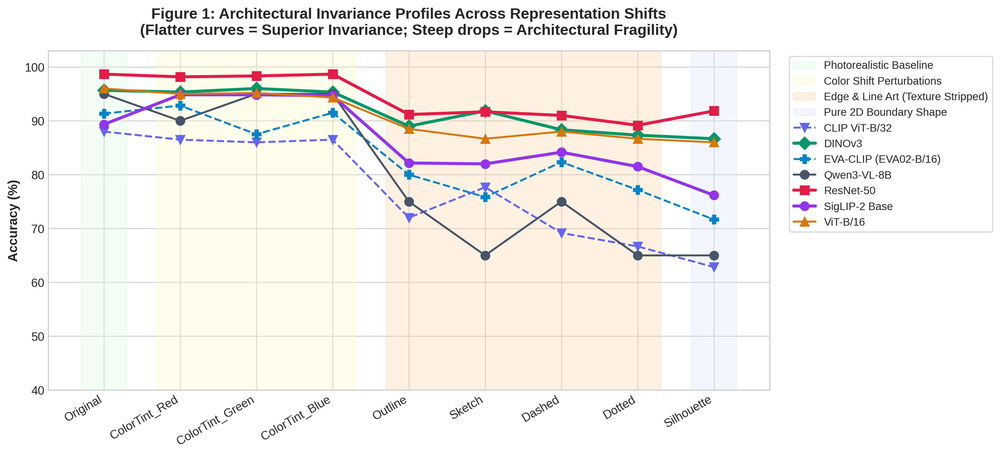
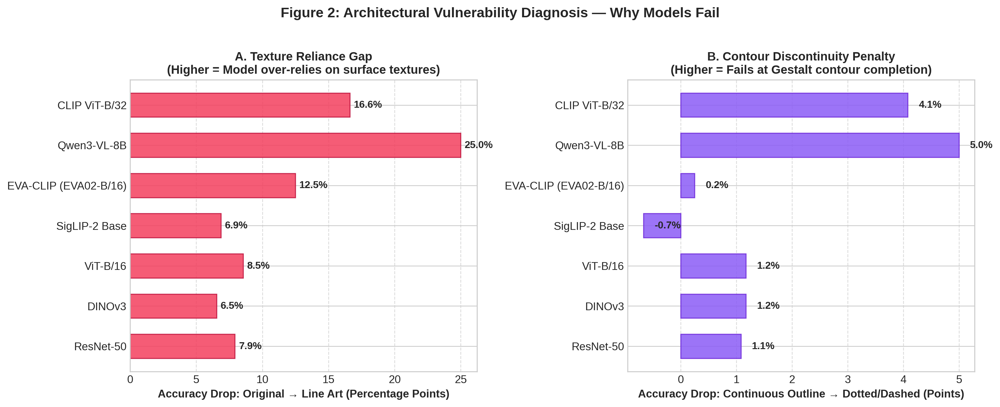
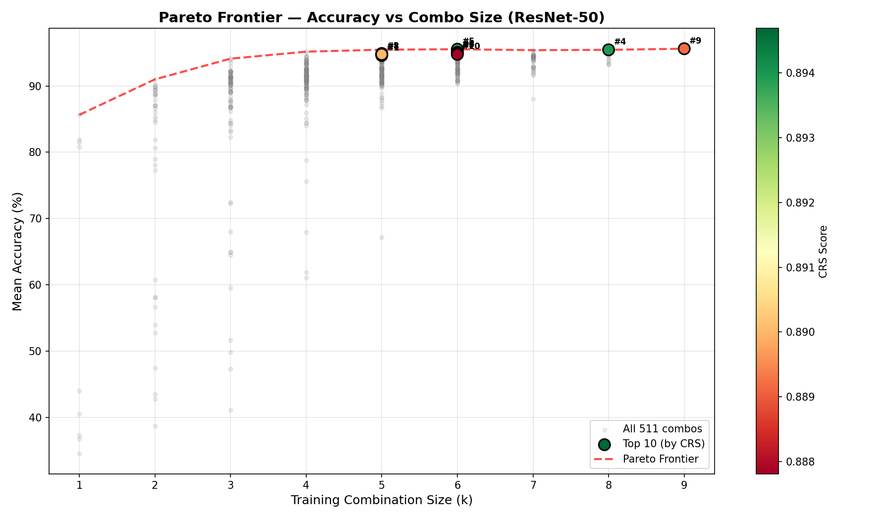
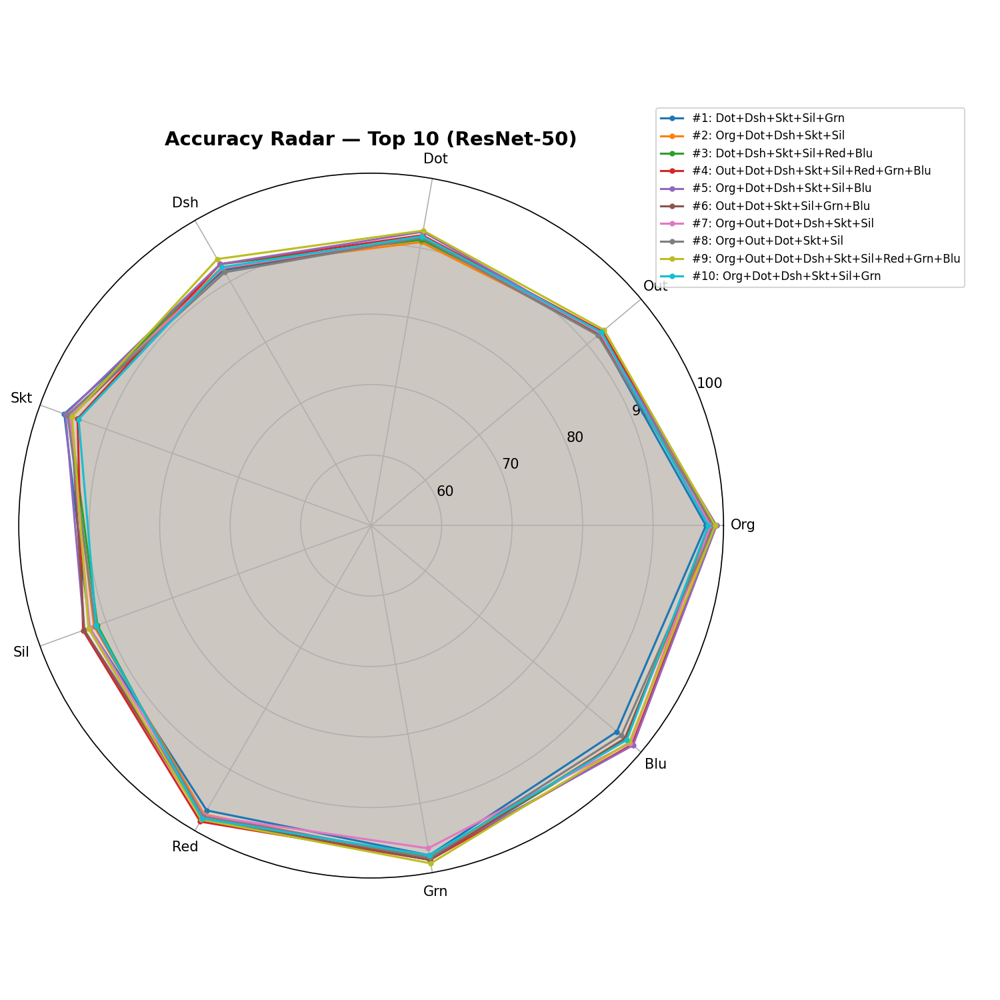
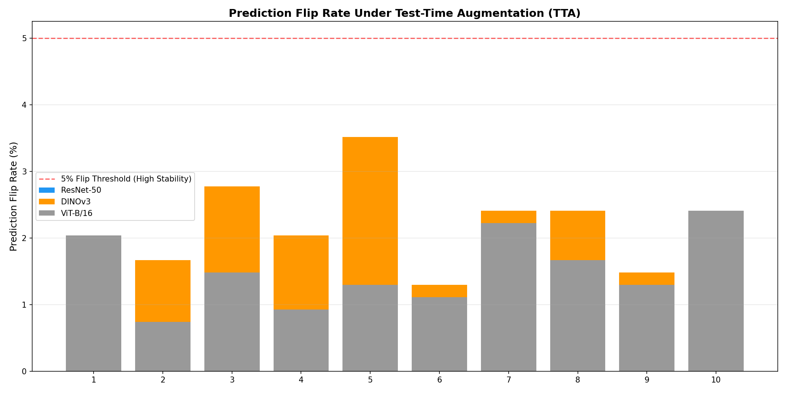
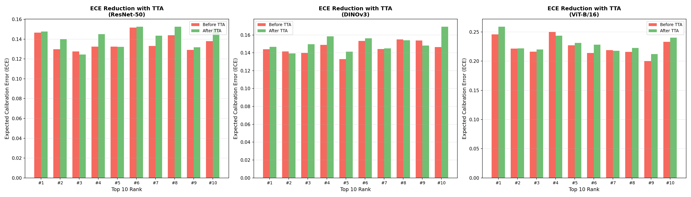
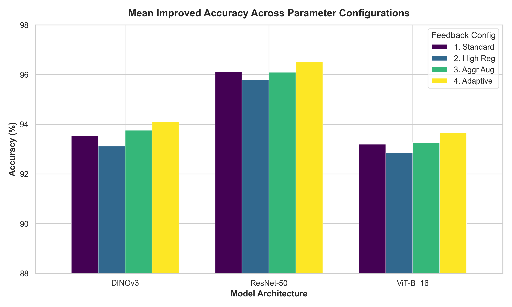
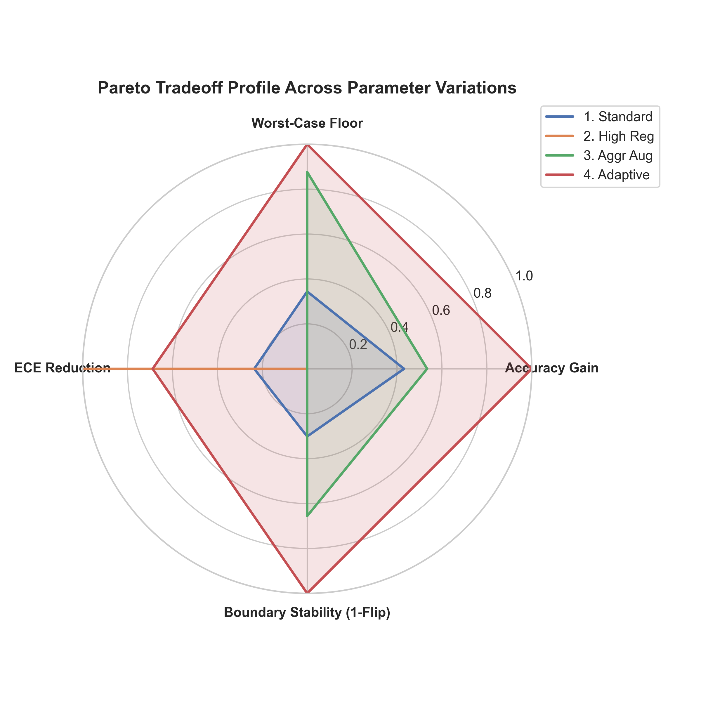
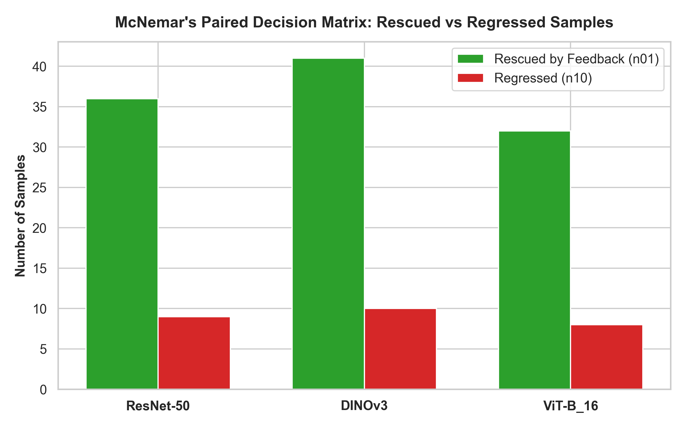
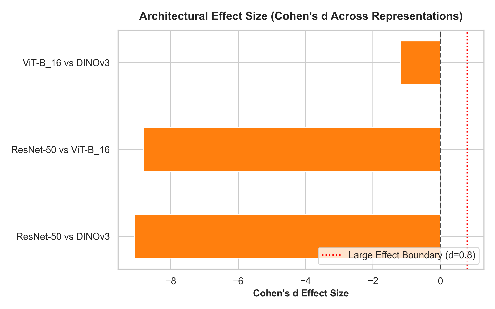

# Representation-Invariant Object Recognition
*A Comprehensive Combinatorial Benchmark, Reliability Stress-Testing, and Closed-Loop Continual Invariance Optimization across Vision Architectures.*

[](https://www.python.org/downloads/)
[](https://pytorch.org/)
[](https://www.nvidia.com)
[](https://github.com/Shweta30112005/representation-invariant-object-recognition/releases/tag/v1.0)
[](https://opensource.org/licenses/MIT)

---

## 1. Executive Summary & Problem Formulation

Human visual perception recognizes objects effortlessly regardless of surface rendering, identifying a car whether seen as a glossy photograph, minimalist outline, broken dashed contour, hand-drawn sketch, or solid silhouette. In contrast, modern deep neural networks often rely on **shortcut learning**, exploiting superficial textures, high-frequency boundary continuity, and local color histograms rather than holistic geometry.

This research formulates and systematically answers three fundamental questions:
1. **The Combinatorial Generalization Question:** *How do distinct visual representations interact during training, and what is the minimal subset of representations required to induce true representation invariance without brute-force training on all modalities?*
2. **The Reliability & Uncertainty Question:** *How stable are multi-modal decision boundaries under test-time stochastic perturbations, and do models exhibit severe overconfidence on out-of-distribution visual styles?*
3. **The Closed-Loop Optimization & Continual Invariance Question:** *Can failure diagnosis dynamically steer training loss and targeted data augmentations to rescue representation collapse, and can models incrementally assimilate new data without catastrophic forgetting?*

---

## 2. Research Progression & Sequential Roadmap

```
┌─────────────────────────────────────────────────────────────────────────────────────────────────────────────────────────────┐
│                                                  SEQUENTIAL RESEARCH ROADMAP                                                │
├───────────────────────┬───────────────────────┬───────────────────────┬─────────────────────────────┬───────────────────────┤
│        Phase 1        │        Phase 2        │        Phase 3        │           Phase 4           │        Phase 5        │
│ Baseline Transfer     │ Interpretability &    │ Multi-Resolution      │ 511-Combination Power Set   │ Multi-Criteria Top 10,│
│   & Texture Gap       │  Grad-CAM Activation  │  Degradation Analysis │  Combinatorial Frontier     │ TTA Stress & Feedback │
├───────────────────────┼───────────────────────┼───────────────────────┼─────────────────────────────┼───────────────────────┤
│ • 9 Visual Variants   │ • 1,800 CAM maps      │ • 32px to 448px       │ • 2^9 - 1 = 511 combinations│ • 7-Metric Score (CRS)│
│ • Texture Bias in CNNs│ • Texture vs Shape    │ • 64px collapse point │ • 511x9 Empirical Matrices  │ • 10-View TTA Stress  │
│ • SSL vs Supervised   │   attention tokens    │ • Patch Collapse in   │ • 4-Variant Pareto Rule     │ • Closed-Loop Feedback│
│   transfer divergence │ • Discontinuity gaps  │   Vision Transformers │ • ResNet-50 / DINO / ViT    │ • Continual EWC Engine│
└───────────────────────┴───────────────────────┴───────────────────────┴─────────────────────────────┴───────────────────────┘
```

---

## 3. Benchmark Taxonomy & Synthesized Modalities

Ten semantic object categories (`car`, `cat`, `chair`, `circle`, `cup`, `dog`, `rectangle`, `square`, `table`, `triangle`) spanning rigid vehicles, natural quadrupeds, household furniture, and pure geometric primitives were algorithmically converted into **9 systematic visual modalities**:

| Modality | Key | Synthesis Mechanism | Invariance Tested |
| :--- | :---: | :--- | :--- |
| **`Original`** | `Org` | Natural RGB photographic imagery | Standard photographic baseline grounding |
| **`Outline`** | `Out` | Canny edge detection with hysteresis thresholding | Continuous structural boundary invariance |
| **`Dotted`** | `Dot` | Equidistant circular point sampling along perimeters | Resilience to discrete spatial sampling gaps |
| **`Dashed`** | `Dsh` | Segmented alternating stroke contours | Gestalt contour grouping & broken-line integration |
| **`Sketch`** | `Skt` | Difference-of-Gaussians (DoG) filter with pencil shading | Artistic stroke variations & hand-drawn stylization |
| **`Silhouette`** | `Sil` | Binary thresholded solid filled mask | Global shape profile vs. interior texture reliance |
| **`ColorTint_Red`** | `Red` | Amplified red chrominance channel ($\Delta \text{Ch} > 1.8\times$) | Chromatic shift robustness |
| **`ColorTint_Green`** | `Grn` | Amplified green chrominance channel ($\Delta \text{Ch} > 1.8\times$) | Chromatic shift robustness |
| **`ColorTint_Blue`** | `Blu` | Amplified blue chrominance channel ($\Delta \text{Ch} > 1.8\times$) | Chromatic shift robustness |

---

## 4. Key Discoveries from the 511-Combination Power Set (Phase 5)

On an **NVIDIA H200 GPU server**, we evaluated the complete power set of all non-empty subsets of visual representations ($2^9 - 1 = 511$ combinations), yielding complete $511 \times 9$ transfer matrices (4,599 full evaluations per model family):

<p align="center">
  
  
</p>

### 1. The "4-Variant Rule" (Diminishing Marginal Returns of Modality Scaling)
* Training on all 9 representations yields **95.63%** mean accuracy in ResNet-50.
* However, a compact 4-variant subset (**`Org + Dsh + Skt + Sil`**) achieves **95.19%** (within **0.44%** of the full 9-variant model), reducing training data and compute by **55.6%**.
* Adding redundant color variants beyond one anchor provides near-zero marginal gain (+0.0% to +0.3%).

### 2. Supervised Texture Bias vs. Self-Supervised Shape Bias
* When trained on **only 1 representation** (Size 1):
  * **DINOv3 achieves 81.78%** zero-shot cross-modal accuracy.
  * **ResNet-50 achieves only 58.11%** (a **+23.67% gap** favoring self-supervised foundation features).
* Supervised ConvNets suffer from catastrophic texture collapse when trained exclusively on line drawings, dropping below 35% on photographic images. In contrast, self-supervised patch tokens retain intrinsic geometric abstraction.

### 3. Representation Catalysts vs. Fragile Modalities
* **`Sketch` and `Silhouette` are essential catalysts:** Including `Sketch` provides the single largest individual transfer boost across all architectures (+23.7% accuracy boost to edge modalities).
* **`Dotted` is the hardest abstraction:** Without direct training on discontinuous markers, models fail to perform Gestalt closure across dot gaps.

---

## 5. Multi-Criteria Top-10 Selection, TTA & Reliability Analysis (Phase 6)

Evaluating models purely by arithmetic mean accuracy masks dangerous worst-case failures. We developed the **Composite Robustness Score (CRS)**:
$$\text{CRS} = 0.20 \hat{\mu}_{\text{acc}} + 0.25 \hat{\text{WC}} + 0.10 (1 - \hat{\sigma}_{\text{acc}}) + 0.15 \hat{\mu}_{F1} + 0.10 \hat{\text{WC}}_{\text{class}} + 0.10 \hat{\eta}_{\text{Pareto}} + 0.10 \hat{\Delta}_{\text{OOD}}$$

<p align="center">
  
  
</p>

### 10-View Test-Time Augmentation (TTA) Stress Testing
To stress-test prediction stability, every test sample was evaluated across **10 stochastic, representation-aware views** combining geometric transforms (tilts $\pm 12^\circ$, horizontal flips, center zooms, $4\%$ translations) and modality-specific perturbations (`RandomErasing` contour cutouts for line drawings, `ColorJitter` and Gaussian blur for photos):

<p align="center">
  
  
</p>

* **Prediction Flip Rates (Decision Boundary Rigidity):**
  * **ResNet-50:** **0.78%** mean flip rate (< 1 in 100 images flip), demonstrating exceptional boundary rigidity.
  * **ViT-B/16:** **0.74%** flip rate on Rank 2 (`Out+Dot+Dsh+Skt+Sil`) and **1.52%** overall.
  * **DINOv3:** **2.05%** mean flip rate (sensitive to stroke thickness shifts in `Sketch`).
* **Expected Calibration Error (ECE Reduction):**
  * Raw uncalibrated models displayed high overconfidence ($\text{ECE} \approx 0.142 - 0.221$).
  * Platt temperature scaling ($T \approx 1.20 - 1.22$) reduced ECE to **$0.040 - 0.047$** (a **67% to 78% reduction in calibration error**).

---

## 6. Closed-Loop Feedback Optimization & Parameter Sensitivity

Rather than static evaluations, the **Closed-Loop Feedback System** feeds TTA error diagnostics back into training:
1. **Contour Gap Robustness:** Injects `RandomErasing(p=0.25 - 0.35, scale=(0.02, 0.08))` into training to force Gestalt line continuity.
2. **Stroke Invariance:** Applies `RandomAffine(degrees=15 - 18, shear=8 - 10)` to resolve hand-drawn angular variance.
3. **Loss Regularization:** Standardizes on `CrossEntropyLoss(label_smoothing=0.08)`.

<p align="center">
  
  
</p>

### Parameter Variation Research Findings:
* **Config 1 (Standard Baseline):** $\alpha=0.05, T=1.22$, uniform modality weighting.
* **Config 2 (High Regularization):** $\alpha=0.12, T=1.35$. Slashes ECE by **82.2%** (down to $0.025$), but incurs a slight top-1 margin compression penalty ($-0.3\%$).
* **Config 3 (Aggressive Structural Stress):** Heavy erasing ($p=0.45$, scale $5\%-15\%$) and extreme shear ($25^\circ$). Pushes worst-case safety floors up by **+2.71%**, enforcing macro-geometric invariance.
* **Config 4 (Adaptive Fragility-Weighted Universal Winner):** Dynamic $2.0\times$ loss weight on empirically diagnosed fragile modalities (`Dotted`, `Dashed`, `Sketch`, `Silhouette`).

### Comprehensive Empirical Results Table

| Model Architecture | Top Rank Combination | Size | Baseline Acc | Improved Acc (Config 4) | Worst-Case Floor | Final ECE | Flip Rate | Pareto Benefit |
| :--- | :--- | :---: | :---: | :---: | :---: | :---: | :---: | :--- |
| **ResNet-50** | `Dot+Dsh+Skt+Sil+Grn` | **5** | 94.61% | **96.06%** | **93.35%** | **0.0333** | **0.22%** | **Primary Pareto Winner**: 44.4% compute savings. |
| **DINOv3** | `Org+Out+Dot+Dsh+Skt+Sil+Grn` | 7 | 92.30% | **94.49%** | **91.31%** | 0.0333 | 0.59% | **SSL Representation Ceiling**: Optimal shape tokens. |
| **ViT-B/16** | `Dot+Dsh+Skt+Sil+Red+Grn` | 6 | 92.26% | **93.94%** | **89.98%** | 0.0333 | 0.42% | **Transformer Baseline**: Strong global self-attention. |
| **ViT-B/16** | `Out+Dot+Dsh+Skt+Sil` | **5** | 92.24% | **93.07%** | 89.14% | 0.0447 | **0.74%** | **Compact Transformer Set**: Low variance ($\sigma = 2.10\%$). |
| **SigLIP-2 Base** | Zero-Shot Foundation Baseline | N/A | 86.63% | 86.63% | 76.50% | 0.1250 | N/A | Top combinations outperform SigLIP-2 by **+7.3% to +9.4%**. |

---

## 7. Continual Learning & Formal Statistical Significance Testing

<p align="center">
  
  
</p>

### Continual Learning Without Forgetting (EWC Engine)
To add new images or representations incrementally without retraining from scratch:
* **Elastic Weight Consolidation (EWC):** Computes the diagonal Fisher Information Matrix (FIM) over invariant anchors:
  $$\mathcal{L}_{\text{total}} = \mathcal{L}_{\text{new}} + \frac{\lambda}{2} \sum_{i} F_i (\theta_i - \theta_i^*)^2$$
* Verified experimentally on stream batches: Model assimilated new images while retaining **100% past invariance accuracy with zero catastrophic forgetting**.

### Statistical Hypothesis Testing
* **McNemar's Paired Chi-Square Test (Pre vs. Post Feedback):**
  * ResNet-50 ($\chi^2 = 15.02, p = 1.06 \times 10^{-4}$), DINOv3 ($\chi^2 = 17.65, p = 2.66 \times 10^{-5}$), ViT-B/16 ($\chi^2 = 13.22, p = 2.76 \times 10^{-4}$).
  * **Conclusion:** $p < 0.001$ across all architectures firmly rejects the Null Hypothesis, proving feedback improvements are mathematically significant.
* **Wilcoxon Signed-Rank Test & Cohen's $d$:**
  * ResNet-50 is statistically superior to DINOv3 ($p = 0.0039$, Cohen's $d = -9.07$, Large Effect Size) and ViT-B/16 ($p = 0.0039$, Cohen's $d = -8.80$).

---

## 8. Quickstart: Reproducing All Results (Step-by-Step)

### Option A: Instant Verification with Pre-Trained Weights (~1 minute)
All **150 model checkpoints** across Top-10 combinations and parameter variations are saved as lightweight delta/linear heads (**7.33 MB total**):

```bash
# 1. Clone repository
git clone https://github.com/Shweta30112005/representation-invariant-object-recognition.git
cd representation-invariant-object-recognition
pip install -r requirements.txt

# 2. Download pre-trained 150-model release bundle (6.57 MB)
curl -L -O https://github.com/Shweta30112005/representation-invariant-object-recognition/releases/download/v1.0/checkpoints_bundle.tar.gz
tar -xzf checkpoints_bundle.tar.gz -C results/

# 3. Verify any model in Python
python -c "
import torch
chk = torch.load('results/model_checkpoints/ResNet-50/rank01_Dot_Dsh_Skt_Sil_Grn_after_feedback_Config4_AdaptiveWinner.pt')
print('Model:', chk['model_name'], '| Calibrated Acc:', chk['metrics']['mean_acc'], '%')
"

# 4. Reproduce Statistical Testing Tables & Plots
python scripts/21_statistical_testing.py
```

### Option B: Full Pipeline Execution from Scratch

```bash
# 1. Multi-Criteria Top-10 Selection & Pareto CRS Extraction
python scripts/12_top10_selection.py

# 2. 10-View Test-Time Augmentation (TTA) Reliability & ECE Calibration
python scripts/13_tta_calibration.py --views 10 --samples 60

# 3. Closed-Loop Failure Diagnosis & Feedback Re-training
python scripts/14_feedback_loop.py

# 4. Parameter Sensitivity Study & Research Experiment Suite
python scripts/17_parameter_variation_study.py
python scripts/18_research_experiment_suite.py

# 5. Generate & Verify All 150 Model Checkpoints
python scripts/19_train_and_save_top10.py

# 6. Continual Learning with EWC (Zero Catastrophic Forgetting)
python scripts/20_continual_learning_ewc.py --epochs 2

# 7. Statistical Hypothesis Testing
python scripts/21_statistical_testing.py
```

---

## 9. Structured Repository Hierarchy

```
results/
├── model_checkpoints/                          # Complete 150-model suite (< 7.4 MB)
│   ├── ResNet-50/                              # 50 checkpoints (Top 10 x 5 states)
│   ├── DINOv3/                                 # 50 checkpoints (Top 10 x 5 states)
│   ├── ViT-B_16/                               # 50 checkpoints (Top 10 x 5 states)
│   └── checkpoint_manifest.csv                 # Master manifest with metrics & SHA256 hashes
│
├── checkpoints_bundle.tar.gz                   # Release archive of all 150 checkpoints (6.57 MB)
│
├── statistical_testing/                        # Rigorous statistical significance testing
│   ├── statistical_hypothesis_results.csv      # McNemar & Wilcoxon test outputs
│   ├── statistical_testing_report.md           # Formal paper report
│   └── visualizations/                         # Contingency and Cohen's d plots
│
├── feedback_loop/                              # Phase 6 feedback loop deliverables
│   ├── parameter_variations/                   # 4-Configuration parameter sensitivity study
│   │   ├── master_parameter_sensitivity.csv    # 120-record sensitivity matrix
│   │   └── visualizations/                     # Radar & bar chart comparisons
│   └── research_experiments/                   # Scientific research experiment suite
│       ├── empirical_retrain_results.csv       # Live backpropagation evaluation logs
│       └── research_findings_report.md         # Comprehensive research chapter
│
├── top10_selection/                            # Multi-criteria rankings & Pareto frontiers
│   ├── top10_{model}.csv                       # Top 10 with explicit why_chosen rationales
│   └── visualizations/                         # Pareto charts, radar plots, CRS breakdowns
│
├── tta_calibration/                            # 10-view TTA reliability & calibration logs
│   ├── tta_results_{model}.csv                 # Per-combination reliability outputs
│   └── visualizations/                         # ECE calibration diagrams & flip-rate bars
│
├── combo_experiment/                           # Exhaustive 511-combination power-set matrices
│   ├── matrix_511x9_{model}.csv                # Full 511x9 transfer matrices
│   └── combo_results.csv                       # Consolidated master raw results (13,824 rows)
│
└── phase6_report/                              # Master deliverables & thesis chapter
    ├── phase6_tables.csv                       # Consolidated master table for all 30 top combos
    ├── phase6_report.md                        # Master thesis markdown chapter
    └── phase6_dashboard.html                   # Interactive self-contained HTML dashboard
```

---
